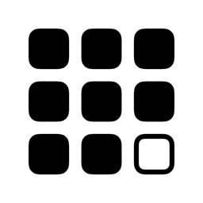
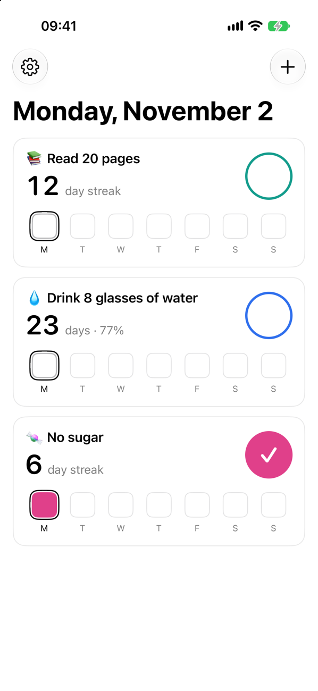
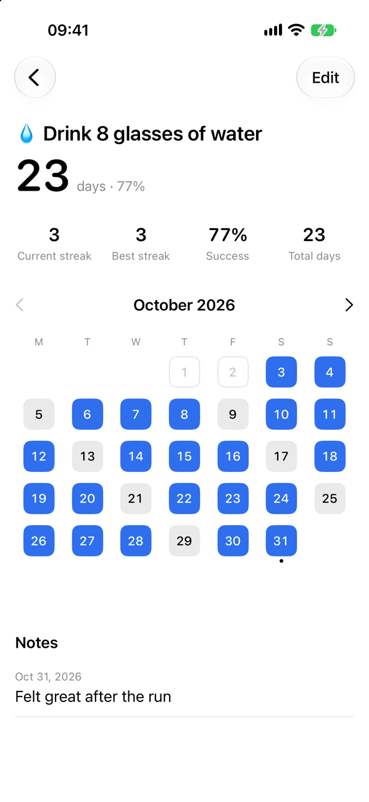
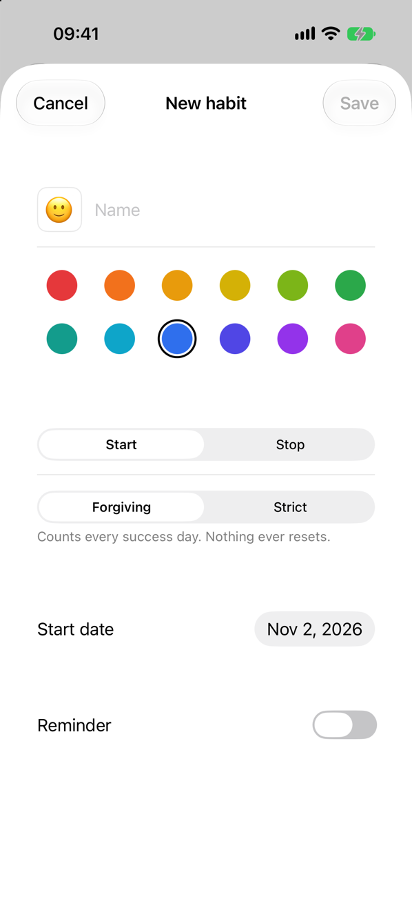
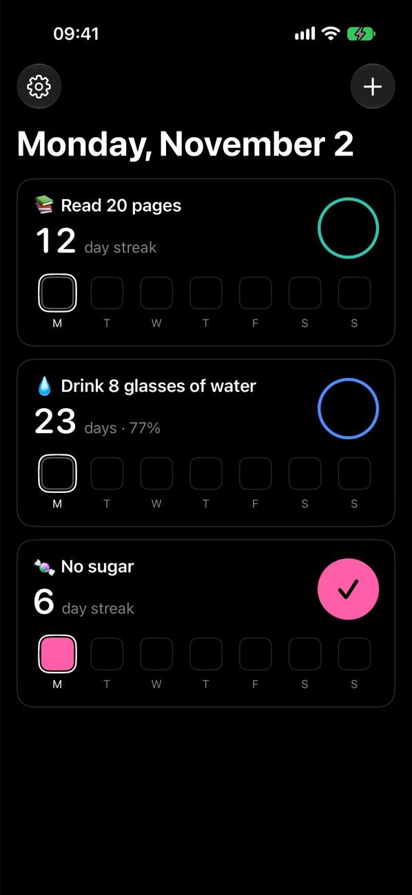
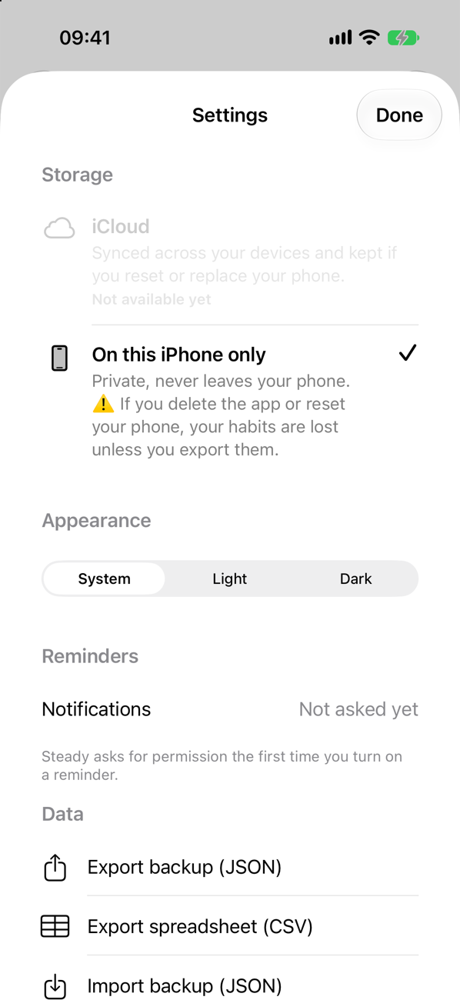
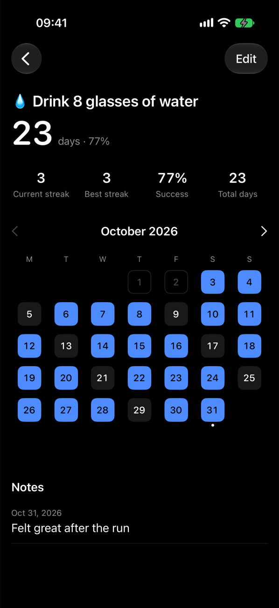

<p align="center">
  
</p>

<h1 align="center">Steady</h1>

<p align="center">
  A tiny, private habit tracker for iPhone.<br>
  Install, add habits, done.
</p>

<p align="center">
  
  
  
  
</p>

## Why

I couldn't find a tiny, simple habit tracker on the App Store. The ones I tried weighed hundreds of megabytes, locked widgets behind subscriptions, or showed ads. I also wanted to see how far [Claude Code](https://claude.com/claude-code) could go in building a native iOS app, so Steady was built with it end to end.

## Features

- **Start or stop habits.** Build a habit, or quit one. Stop habits can count every day as clean automatically, so you only log slips.
- **Strict or forgiving.** Strict shows your current streak. Forgiving counts every success day, so one bad day never resets your progress.
- **Backdating.** Start a habit in the past, with an optional "I did it every day since then".
- **Widgets.** Small, medium and large Home Screen widgets, all free.
- **Notes and history.** Add a note to any day and browse past months in a calendar.
- **Smart reminders.** A daily reminder per habit that stays quiet once you've logged the day.
- **Your data, your files.** Export a JSON backup or a CSV spreadsheet, and import backups.
- **Black and white by design.** Color comes only from your habits. True black in dark mode.
- **In English, French, Spanish and German.**

## Principles

| | |
|---|---|
| **Small** | Under 5 MB. Pure SwiftUI, zero third-party dependencies. |
| **Private** | No account, no analytics, no tracking. Steady collects no data. |
| **Fair** | Every feature is free. One optional purchase adds cosmetic extras (icons and colors), never features. |

<p align="center">
  
  
</p>

## Tech

Swift 6 · SwiftUI · SwiftData · WidgetKit · App Intents · UserNotifications · StoreKit 2 · iOS 17+

- Days are stored as integer keys (`20261102`), not `Date`s, so streaks survive time zones and daylight saving changes.
- All counting logic is pure and unit tested (`Shared/DayResolver.swift`, `Shared/HabitStats.swift`).
- Widgets read a small JSON snapshot written by the app, never the database.

## Build

Requires Xcode and [XcodeGen](https://github.com/yonaskolb/XcodeGen).

```sh
brew install xcodegen
xcodegen generate
open Steady.xcodeproj
```

Run tests:

```sh
xcodebuild test -scheme Steady -destination 'platform=iOS Simulator,name=iPhone 17'
```

The Supporter Pack can be tested for free in the simulator through the bundled `Steady.storekit` configuration (run from Xcode). iCloud sync is implemented but switched off (`FeatureFlags.iCloudSync`) until the iCloud container is set up.

## Project layout

```
Steady/          App: features, SwiftData models, services, resources
Shared/          Code shared by the app and widgets (days, counting, snapshot, palette)
SteadyWidgets/   Widget extension
SteadyTests/     Unit tests
tools/           Icon rendering and String Catalog generation
```
